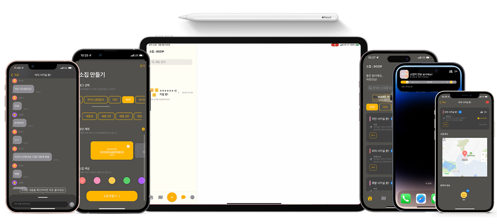 

# 소집 : SOZIP  
### An Application for Delivery Cost Dutch Pay 
###### '소집(SOZIP) means to gather (people, etc.) in Korean.'
ⓒ 2021 Changjin Ha, Sojung Moon. All Rights Reserved.  

## 🚀 Tech Stack

### Client (Android)

</a>
</a>

### Backend (BaaS & Serverless)

- Firebase Firestore: Realtime chat and sync SOZIP data
- Firebase Cloud Functions: Process backend business logic for reduce client burden
- Firebase Cloud Messaging: Send push notifications to target user when created new SOZIP and chat

### External API

- Naver Maps API (Render location based markers)

## 🏗️ Architecture

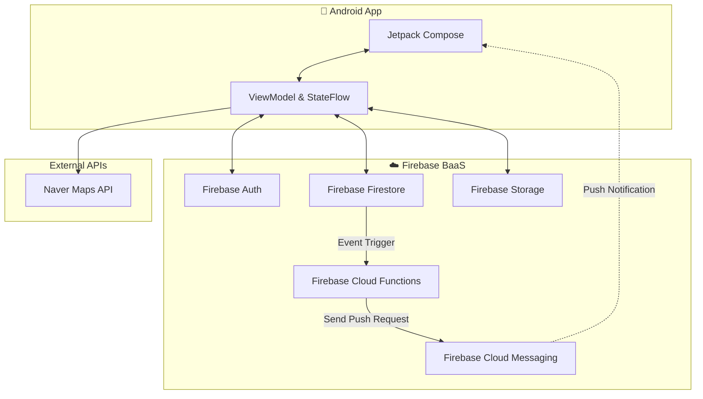

## 🧱 If I were to rebuild it in 2026

| Layer | Original | 2026 Pick | Reason |
|---|---|---|---|
| UI | Jetpack Compose (M2 + M3) | Jetpack Compose + Material 3 | Consistent design system |
| State management | `companion object` + callback | `ViewModel` + `StateFlow` + `collectAsStateWithLifecycle` | Lifecycle-aware, test available |
| Async | `addOnCompleteListener` nested callback | `suspend fun` + `kotlinx-coroutines-play-services` `.await()` | Serialized code, clerable error handling |
| Encrypt | NDK + `Android.mk` (AES256) | Android keystore system + `javax.crypto` | Isolate the key in TEE, unnecessary NDK |
| Process date | `SimpleDateFormat` | `java.time.format.DateTimeFormatter` | Thread-safe, unnecessary desugaring in minSdk 29 |

## ✨ Core Features 

Show Contents

#### Home 
> Check any SOZIPs near by you, or notifications  

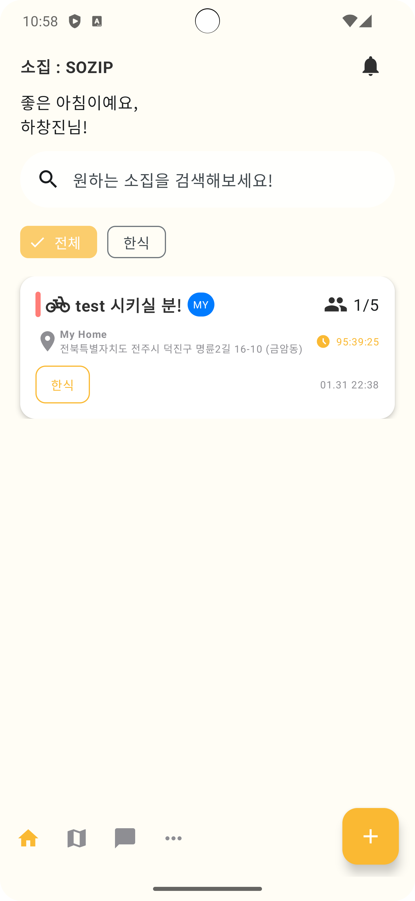
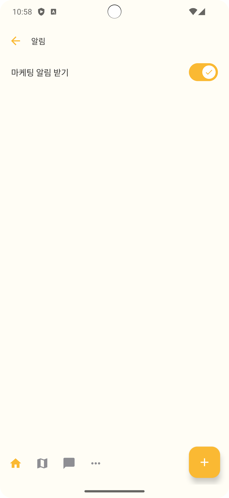 

#### SOZIP Map 
> Check and contact to all SOZIPs  

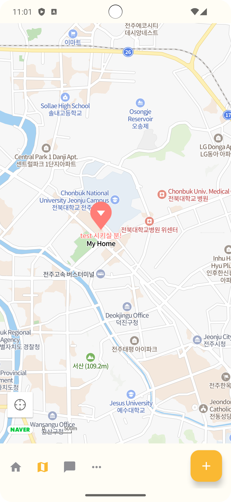 

#### SOZIP 
> Check location, participants, or manage your SOZIP in SOZIP Details 

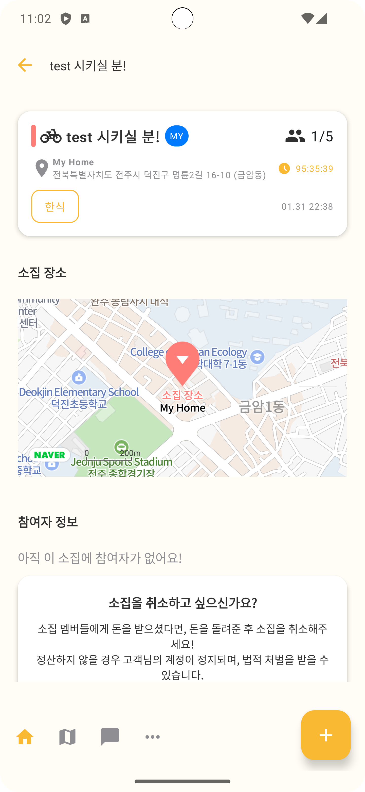 

> Don't you have a favorite SOZIP? Feel free to make it! 

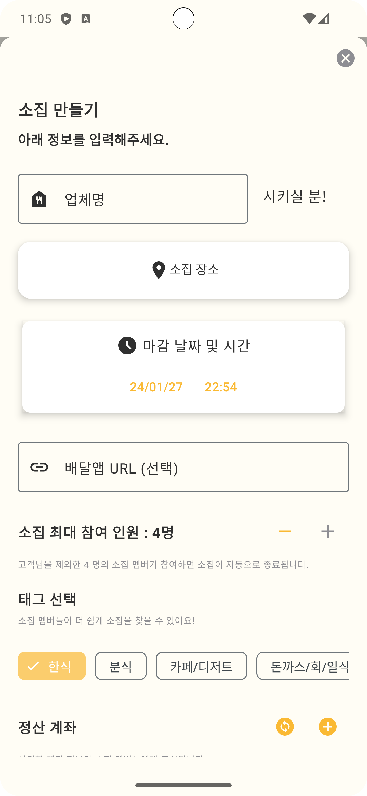
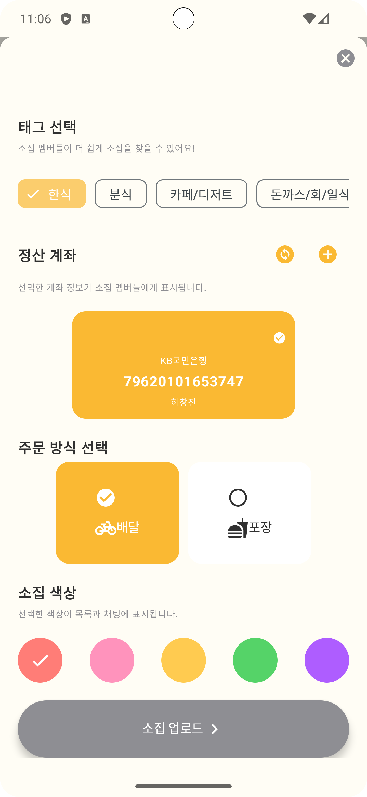 

#### Chat 
> Feel free to talk to the participants  

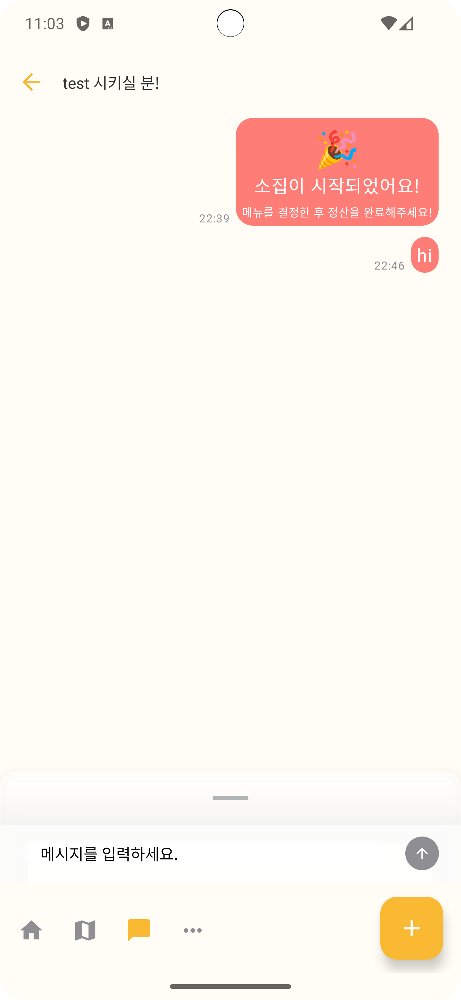 

> Or you can send any images, bank accounts, or manage your SOZIP. it's so easy.  

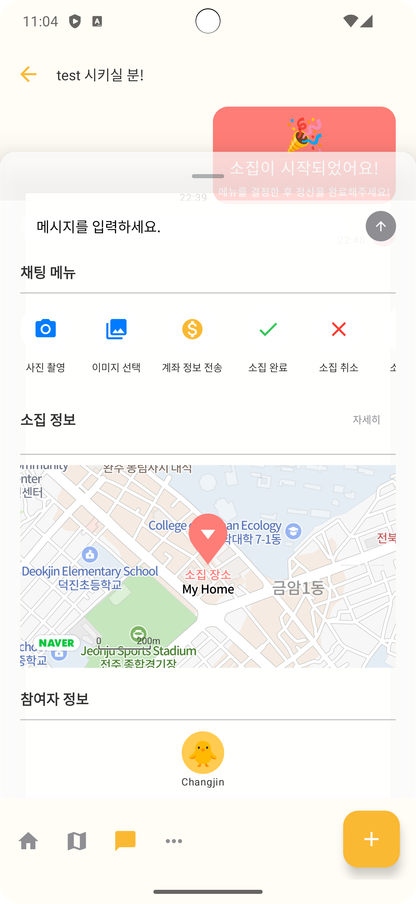 

#### Profile 
> Show others your unique personality in your profile  

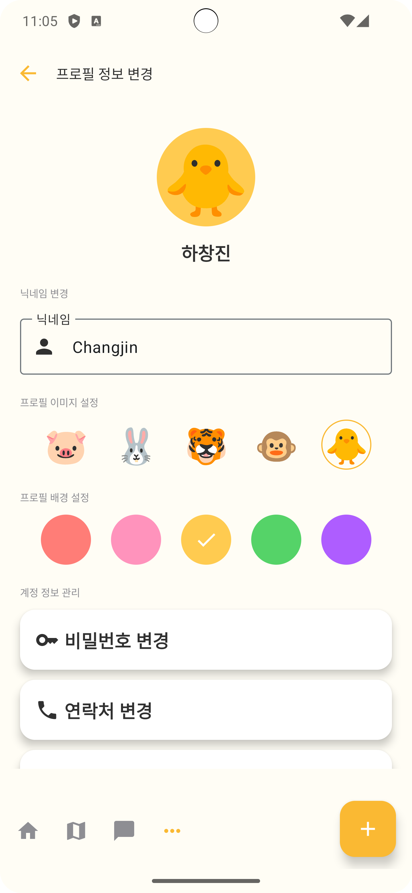 

#### Feedback Hub 
> Improve 소집 : SOZIP with your opinion.  

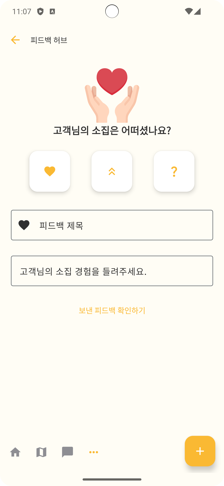 

#### And so much more. 
> Notice, Consult, or you can change your informations  

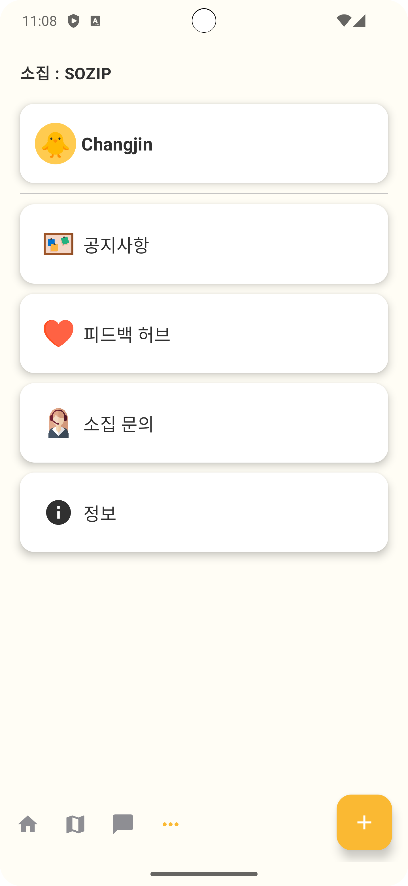

